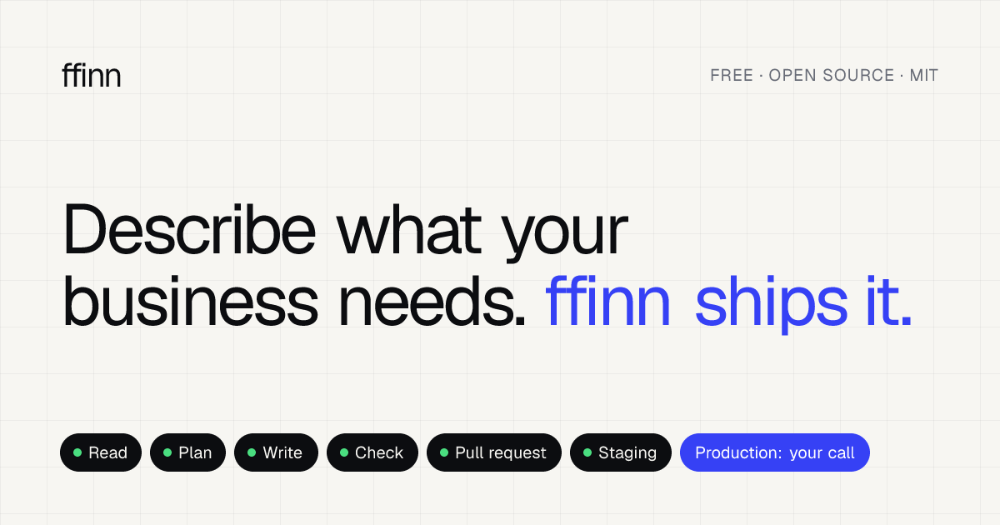
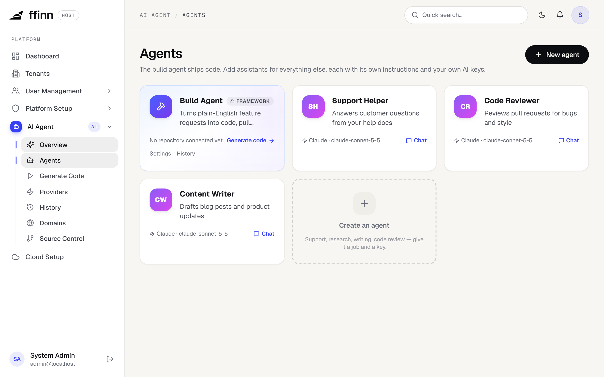
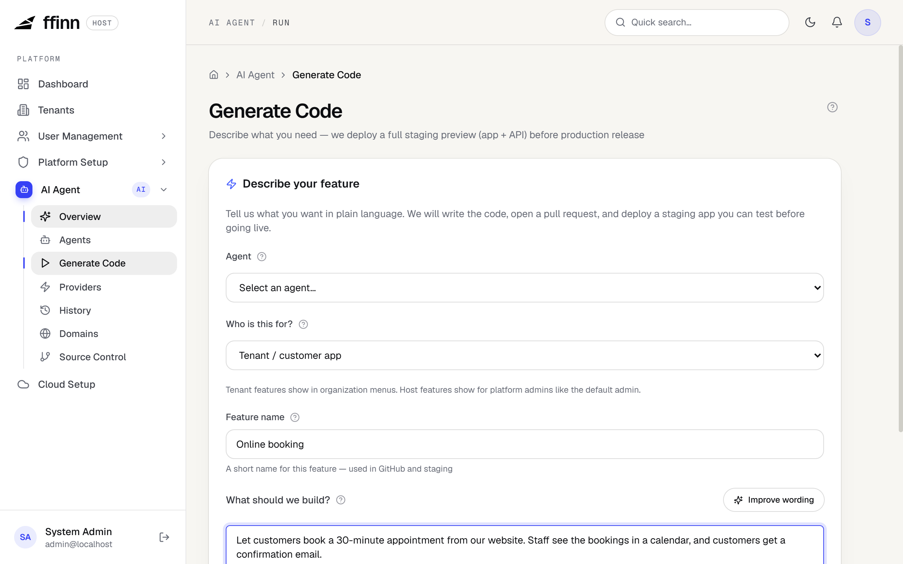
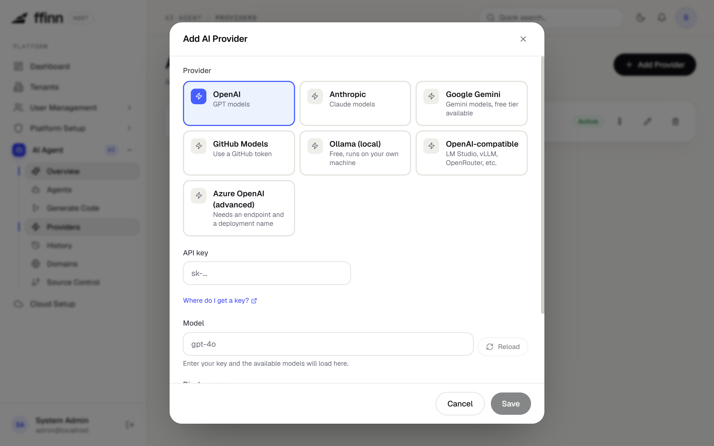

# ffinn — free, open-source AI SaaS framework

[](https://github.com/bplogan/ffinn/actions/workflows/ci.yml)
[](LICENSE)
[](https://ffinn.ca)

[](https://ffinn.ca)

**ffinn** is a free, MIT-licensed, **multi-tenant SaaS starter kit** with built-in **AI agents**. You get a production-minded foundation (auth, roles, billing, admin) plus:

- a **build agent** that turns plain-English feature requests into code, pull requests, staging deployments and production releases, and
- **chat assistants** you create yourself, each with its own instructions, file uploads and conversation history, like the ChatGPT and Claude web apps but on your own stack.

Bring your own keys for OpenAI, Anthropic Claude, Google Gemini, Azure OpenAI, GitHub Models, Ollama or any OpenAI-compatible server. No licence fees and no vendor lock-in.

Built with a **Python/FastAPI** backend and a **Next.js** frontend. Website and docs: **[ffinn.ca](https://ffinn.ca)**.

**Try it in a few minutes:** all you need is Docker. See the [Quick Start](#quick-start).

## Features

- **Multi-tenancy**: tenant isolation, tenant management, per-tenant branding
- **Identity and access**: JWT auth, roles and fine-grained permissions, 2FA, SSO (OIDC and SAML 2.0), team invitations, delegation, audit logs
- **Billing**: subscription plans and editions, registration paywall, Stripe and PayPal
- **Notifications**: email (SMTP), SMS, push, and in-app/WebSocket channels
- **AI build agent**: describe a feature, review the generated branch/PR, deploy to staging, promote to production, or revert. Generated code is checked against the framework's patterns.
- **AI chat assistants**: create as many agents as you need, each responsible for its own job. Streaming chat, file and image upload, and per-user history.
- **Bring your own AI**: OpenAI, Anthropic Claude, Google Gemini, Azure OpenAI, GitHub Models, Ollama, or any OpenAI-compatible server. Live model lists and a connection test before you save.
- **Cloud setup**: a guided wizard that checks your Azure, AWS, GCP or Oracle Cloud credentials and adds a CI/CD workflow to your GitHub repository. ffinn.ca itself runs on the AWS reference setup in `infra/aws/`
- **Admin console**: users, roles, tenants, settings, feature flags, audit logs

## Screenshots

**Agents.** The build agent ships code; assistants handle everything else, each with its own instructions and AI key.



<table>
  <tr>
    <td width="50%"><b>Build agent.</b> Describe a feature in plain English. ffinn writes it, opens a pull request and deploys a staging preview.</td>
    <td width="50%"><b>Bring your own AI.</b> OpenAI, Claude, Gemini, GitHub Models, a local Ollama or any OpenAI-compatible server.</td>
  </tr>
  <tr>
    <td></td>
    <td></td>
  </tr>
</table>

## Contributing

ffinn is MIT licensed and contributions are very welcome. Read [CONTRIBUTING.md](CONTRIBUTING.md) to get started, and please follow our [Code of Conduct](CODE_OF_CONDUCT.md). Found a vulnerability? See [SECURITY.md](SECURITY.md).

## Repository Structure

```
ffinn/
├── python-backend/   # FastAPI backend — REST API, auth, AI agents, multi-tenancy
├── nextjs-frontend/  # Next.js frontend — public site, docs, portal, admin UI
├── infra/aws/        # Reference AWS deployment (runs ffinn.ca)
├── .github/          # CI, deploy workflows and contribution templates
└── docker-compose.yml
```

## Quick Start

You only need two things installed: **[Git](https://git-scm.com/downloads)** and **[Docker Desktop](https://www.docker.com/products/docker-desktop/)** (open it once so it's running). No Python, Node or database setup.

**1. Get the code and start it**

```bash
git clone https://github.com/bplogan/ffinn.git
cd ffinn
docker compose up -d --build --wait
```

The first run downloads and builds everything, so give it a few minutes. The command finishes once the app is ready.

**2. Sign in**

Open **http://localhost:3000/auth/login** and sign in with:

- Email: `admin@localhost`
- Password: `ChangeMe123!`

That's it, ffinn is running.

**3. Try it (about 2 minutes)**

1. Go to **AI Agent → Agents → Create an agent**.
2. Give it a name, pick an instructions template (for example **Customer support**), choose a provider and paste your API key. OpenAI, Claude, Gemini (has a free tier) and others work. Click **Test connection**, then **Create agent**.
3. Open the agent and start chatting.

Using **Ollama** on your own machine? With Docker, set its URL to `http://host.docker.internal:11434`, not `localhost`.

The **build agent** (turns feature requests into pull requests) also needs a GitHub repository connected under **AI Agent → Source Control**. Do that once the basics are working.

### Stop, restart or start over

| To | Run |
|---|---|
| Stop ffinn | `docker compose down` |
| Start it again | `docker compose up -d --wait` |
| Wipe all data and start fresh | `docker compose down -v` |
| See what went wrong | `docker compose logs api` |

### If something goes wrong

| Problem | Fix |
|---|---|
| `Cannot connect to the Docker daemon` / `dockerDesktopLinuxEngine` | Docker Desktop isn't running. Open it, wait until it says it's running, then run the command again. |
| `port is already allocated` / `address already in use` | Something else is using port 3000 or 8000 (often another dev server). Stop it, or change the left-hand port in `docker-compose.yml`. |
| Sign-in says the password is wrong | You probably started ffinn before with a different admin password. Run `docker compose down -v` to reset, then start again. |
| Anything else | Run `docker compose logs api` and [open an issue](https://github.com/bplogan/ffinn/issues) with the output. |

> This setup uses public development passwords and keys, so keep it on your own machine. See [Deploying](#deploying) before putting ffinn online.

## Developing without Docker

Only needed if you want to change the code with hot reload. You need **Python 3.12**, **Node.js 20 or newer**, and Docker for the database.

**Database** (from the repo root):

```bash
docker compose up -d db
```

**Backend** (in one terminal):

```bash
cd python-backend
python -m venv .venv
# Windows: .\.venv\Scripts\Activate.ps1
# macOS/Linux: source .venv/bin/activate
pip install -r requirements-dev.txt
cp .env.example .env
alembic upgrade head
uvicorn app.main:app --reload --port 8000
```

The defaults in `.env.example` already match the Docker database, so you don't need to edit anything. API docs are at http://localhost:8000/docs.

**Frontend** (in a second terminal):

```bash
cd nextjs-frontend
npm install
cp .env.example .env.local
npm run dev
```

Open http://localhost:3000 and sign in with the same admin account.

## Tech Stack

| Layer | Technology |
|---|---|
| Backend | Python 3.12, FastAPI, SQLAlchemy 2 (async), Alembic, PostgreSQL |
| Auth | JWT + bcrypt, TOTP 2FA, SSO (OIDC and SAML 2.0) |
| Payments | Stripe, PayPal |
| AI | Multi-provider (OpenAI, Anthropic, Google Gemini, Azure OpenAI, GitHub Models, Ollama, OpenAI-compatible) |
| Frontend | Next.js 16, React 19, TypeScript, Tailwind CSS |
| State | TanStack Query |

## Environment Variables

### Backend (`python-backend/.env`)

| Variable | Description |
|---|---|
| `DATABASE_URL` | PostgreSQL connection string |
| `JWT_SECRET_KEY` | JWT signing key (min 32 characters) |
| `ENCRYPTION_KEY` | Fernet key for encrypting AI provider API keys |
| `APP_URL` | Frontend base URL (default `http://localhost:3000`) |
| `API_BASE_URL` | Public API URL, used for CI callbacks |
| `CORS_ORIGINS_RAW` | Comma-separated allowed CORS origins |
| `CALLBACK_TOKEN` | Shared secret for build-agent CI callbacks |
| `DEFAULT_ADMIN_EMAIL` | Seed admin email for first login |
| `DEFAULT_ADMIN_PASSWORD` | Seed admin password for first login |
| `ALLOW_REGISTRATION` | Allow self-service sign-up (default `true`) |
| `MULTI_TENANCY_ENABLED` | Enable multi-tenancy |
| `STRIPE_SECRET_KEY` | Stripe secret key |
| `STRIPE_WEBHOOK_SECRET` | Stripe webhook signing secret |

Copy `python-backend/.env.example` for a full list.

### Frontend (`nextjs-frontend/.env.local`)

| Variable | Description |
|---|---|
| `NEXT_PUBLIC_API_URL` | Base URL of the backend API |

## Deploying

**Before going live:** generate your own secrets and set `ENVIRONMENT=production`. In production the backend refuses to start if `JWT_SECRET_KEY` is shorter than 32 characters, `ENCRYPTION_KEY` is empty or shorter than 32 characters, or `JWT_SECRET_KEY`, `ENCRYPTION_KEY`, `CALLBACK_TOKEN` or `DEFAULT_ADMIN_PASSWORD` is a value published in this repo (`docker-compose.yml`, `.env.example`, the CI workflows, or anything starting with `CHANGE-THIS`); `STAGING_DEMO_PASSWORD` is checked too when `SEED_STAGING_DEMO=true`. It does not check the database password or judge the strength of other values.

The deploy workflows in `.github/workflows/` (`aws-deploy-*.yml`, `ai-agent-*.yml`) ship ffinn.ca itself and only run in `bplogan/ffinn`. If you fork ffinn, change the `github.repository` guards and configure your own secrets and variables (the `secrets.*` and `vars.*` the workflows reference). [`infra/aws/README.md`](infra/aws/README.md) documents the AWS setup (Lightsail, Caddy, ECR, staging for the build agent, DNS, rollback). The portal's Cloud Setup page can provision other clouds, and the build agent's workflow templates are in `python-backend/app/ai_agent/templates/workflows/`. Nothing in this repository contains credentials, and you should never commit yours.

## Security

See [SECURITY.md](SECURITY.md) for reporting vulnerabilities.

## License

[MIT](LICENSE)
